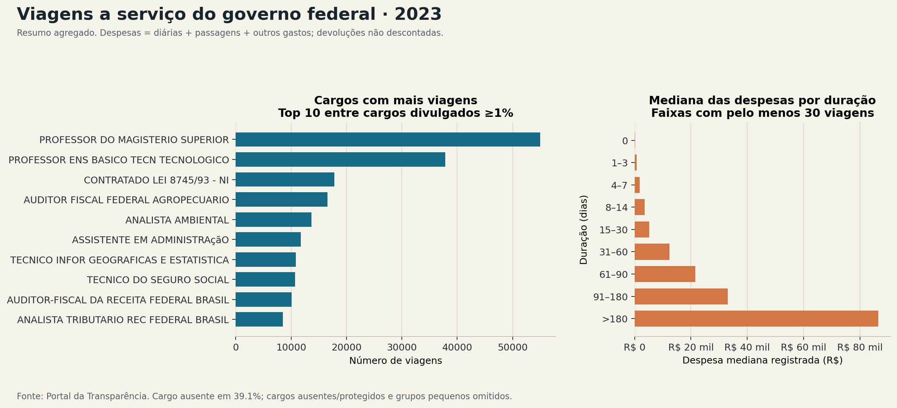

# Viagens a serviço do governo federal em 2023

Uma análise exploratória, feita em Python, sobre a quantidade, a duração e as despesas registradas para viagens a serviço. O projeto usa dados do Portal da Transparência e apresenta resultados agrupados por cargo e por faixa de duração.

## Tecnologias

- **Python** para a análise;
- **pandas** para leitura, tratamento e agregação dos dados;
- **Matplotlib** para os gráficos;
- **Jupyter Notebook** para documentar o processo de forma reproduzível.

## Etapas da análise

- Leitura seletiva do CSV, carregando apenas as seis colunas necessárias;
- tratamento de datas, valores ausentes e categorias de cargo;
- cálculo da duração e das despesas consideradas;
- agregação por cargo e faixa de duração, com critérios explícitos para grupos pequenos;
- criação de gráficos e registro das limitações dos dados.

## O que a análise investiga

- Como o número de viagens se distribui entre os cargos?
- Como variam a quantidade de viagens e a mediana das despesas por cargo?
- Como a mediana das despesas muda entre faixas de duração?

O notebook explica as etapas, os cálculos e os limites da análise. As despesas consideradas são a soma de diárias, passagens e outros gastos, desde que os três valores estejam disponíveis; devoluções não entram nesse cálculo. A mediana ajuda a reduzir a influência de valores muito altos.

**Limitação dos dados:** 325.565 das 833.057 viagens (39,1%) não têm cargo informado. Por isso, o gráfico de cargos usa somente registros com cargo identificado e divulgado; essa proporção aparece também na tabela de qualidade do notebook.

## Como reproduzir

1. Baixe o arquivo `2023_Viagem.csv` referente a 2023 na página de [dados de viagens do Portal da Transparência](https://portaldatransparencia.gov.br/download-de-dados/viagens).
2. Coloque o arquivo neste caminho: `data/raw/2023_Viagem.csv`.
3. Instale as bibliotecas: `pip install -r requirements.txt`.
4. Abra `analise_viagens_2023.ipynb` no Jupyter e execute as células na ordem.

O CSV não faz parte do repositório. Ele é grande, pode conter informações de pessoas e itinerários, e deve ser baixado diretamente da fonte indicada. O notebook lê somente seis colunas necessárias (cargo, datas e valores), sem carregar nomes, CPFs, identificadores ou detalhes de itinerário.

## Privacidade

O notebook preparado para publicação não salva resultados de execução nem mostra linhas individuais. A imagem deste README e as tabelas do notebook mostram grupos agregados; cargos sem informação ou protegidos por sigilo são omitidos dos gráficos, assim como faixas com menos de 30 viagens. O notebook original de trabalho e os arquivos CSV estão excluídos do Git por regras em `.gitignore`.

Antes de publicar, revise os arquivos preparados e evite adicionar dados brutos, capturas de tela com registros individuais, credenciais ou informações pessoais.

## Como interpretar

Este é um exercício exploratório, não uma auditoria. Registros incompletos podem afetar os resultados; a duração é a diferença entre as datas de início e fim; e as despesas não descontam devoluções. O total por cargo considera apenas registros com os três componentes de despesa preenchidos. Comparações entre grupos descrevem padrões e não demonstram causa e efeito.
